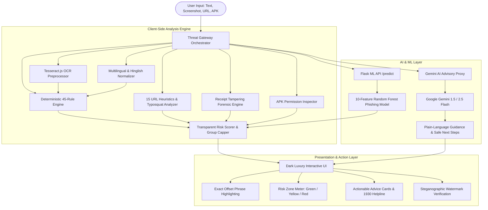

<div align="center">

# 🛡️ Growmap x Scamy — Scam Spotter AI
### Explainable Cybersecurity & Multi-Modal Fraud Detection Intelligence Platform

[](https://www.typescriptlang.org/)
[](https://python.org)
[](https://vitejs.dev/)
[](https://flask.palletsprojects.com/)
[](https://vitest.dev/)
[](https://github.com/Ohmcreates/growmap_X_scamy)
[](LICENSE)

*Built for students, elders, and families across India to instantly detect deceptive messages, fraudulent websites, malicious APKs, and fake payment requests before financial harm occurs.*

[Live Demo](#-live-demo--quick-walkthrough) • [Key Features](#-core-capabilities) • [System Architecture](#-system-architecture) • [Getting Started](#-getting-started) • [API Documentation](#-api-endpoints) • [Benchmark Matrix](#-benchmarks--testing)

---

</div>

## 📌 Problem Statement

Students, working professionals, and families frequently receive urgent SMS, WhatsApp messages, emails, and phone calls masquerading as:
* **Nationalized & Private Banks** (*SBI YONO, HDFC Bank, ICICI, Axis*) warning of immediate account suspension or expired KYC.
* **Government Departments & Law Enforcement** (*Traffic Police e-Challan, CBI / ED / Cyber Cell "Digital Arrest"*).
* **Utility Services** (*State Electricity Boards threatening immediate power disconnection at 9:30 PM*).
* **E-Commerce & Courier Services** (*India Post, BlueDart, DTDC failed delivery packages*).
* **Part-Time Task & Telegram Job Scams** (*YouTube video liking, crypto rating, deposit multiplier schemes*).

Many of these messages look strikingly real, leading victims to act before they think.

**Scam Spotter** solves this by providing an **instant, explainable, multi-modal verification suite**. When a user pastes a message, uploads a screenshot, tests a URL, or inspects a receipt, Scam Spotter extracts the warning signs with exact character offsets, calculates a transparent risk score (0–100), outputs plain-language explanations, and provides actionable regulatory next steps (including India's 1930 Cyber Fraud Helpline and Sanchar Saathi reporting).

---

## ⚡ Core Capabilities

### 1. 🔍 Deterministic Rule Engine & Exact Evidence Highlighting
* **45-Character Negation Context Windows**: Distinguishes genuine bank security alerts (*"Do not share your OTP with anyone"*) from actual phishing attacks (*"Share your OTP immediately to avoid account block"*).
* **Exact Character Offset Highlighting**: Evidence phrases are visually wrapped in XSS-safe DOM elements with distinctive category underlining (solid, dashed, wavy) linked directly to explanation cards.
* **Transparent Additive Risk Scoring (0–100)**: Integer arithmetic scoring with category group caps (e.g. credential harvesting capped at 40 pts) ensuring no single trigger inflates benign messages.
* **Calibrated Risk Zones**:
  * 🟢 **Safe / Low Risk (0–20 pts)**: Legitimate messages, standard advisories, verified domains.
  * 🟡 **Suspicious / Medium Risk (21–44 pts)**: Missing context, aggressive sales tactics, unverified shorteners.
  * 🔴 **High Risk / Danger (45–100 pts)**: Confirmed credential harvesting, impersonation, UPI tricks, digital arrest coercion.

### 2. 🌐 15 Production URL Heuristic Forensics & ML Phishing Classifier
* **Dual-Engine URL Analysis**: Combines deterministic heuristic rules with a 10-feature scikit-learn Random Forest model.
* **Forensic URL Inspections**:
  * Levenshtein Distance & Typosquatting (*e.g., `sbi-kyc-update.com`, `hdfc-netbanking.support`*)
  * Punycode / IDN Homoglyph attack detection (*Cyrillic `а` vs Latin `a`*)
  * IP Address Hostnames & Hex Encodings (*e.g., `http://192.168.1.1/login`*)
  * Subdomain Deep-Stacking (*e.g., `login.sbi.co.in.scam-domain.xyz`*)
  * Dangerous TLD profiling (`.top`, `.xyz`, `.click`, `.download`, `.cn`, `.rest`)
  * Deceptive Action Paths (`/echallan/pay`, `/kyc/pan_verify`)
  * URL Shortener Resolution & Unmasking (`bit.ly`, `tinyurl.com`, `is.gd`)

### 3. 🇮🇳 Specialized Indian Fraud Typology Profiles
* **UPI Payment Tricks**: Detects reverse-PIN traps (*"Enter PIN to receive prize money"*), fraudulent collect requests, fake refund QR codes, and wrong transfer extortion.
* **Digital Arrest Extortion**: Identifies fake CBI/ED notices, illegal package confiscation claims, Skype video interrogation demands, and forged Supreme Court orders.
* **Traffic Police e-Challan Spoofs**: Flags deceptive fine notices directing drivers to unauthorized `.net` or dynamic redirect payment portals instead of `echallan.parivahan.gov.in`.
* **Electricity & Utility Cutoff**: Flags nighttime disconnection warnings demanding calls to personal 10-digit mobile numbers.
* **Part-Time Task & Investment Frauds**: Detects Telegram daily salary promises, merchant task deposits, and crypto guaranteed return lures.

### 4. 🖼️ Multi-Modal Client-Side OCR & Receipt Tampering Forensics
* **Tesseract.js In-Browser OCR**: Extracts text from screenshots without sending user images to an external server.
* **HTML5 Canvas Preprocessing**: Adaptive thresholding, contrast maximization, and binarization for clear text extraction even from low-resolution mobile screenshots.
* **Payment Receipt Forensics**: Audits transaction screenshots for font mismatches, misaligned timestamps, fake UTR / transaction IDs, and fraudulent payment confirmation templates.

### 5. 🗣️ Multilingual & Hinglish Natural Language Support
* **Devanagari Script Engine**: Direct recognition of Hindi scam messages (*"आपका बैंक खाता ब्लॉक कर दिया गया है"*).
* **Phonetic Hinglish Transliteration**: Matches common Romanized Hindi urgency triggers (*"khata band ho jayega"*, *"turant KYC update karein"*, *"bijli cut jayegi"*, *"paise bhejo"*).
* **Unicode NFKC Canonical Normalization**: Defeats zero-width character insertion and homoglyph obfuscation.

### 6. 🤖 Google Gemini AI Cybersecurity Advisory Layer
* **4 Dedicated Security Purposes**:
  1. Deep semantic contextual threat reasoning
  2. Plain-language threat explanation tailored to elderly and non-technical users
  3. Safe mitigation roadmap & regulatory reporting instructions
  4. Cross-language Hinglish translation and nuance extraction
* **Strict PII Redaction**: Phone numbers, debit/credit cards, and bank account numbers are scrubbed before inference.
* **Dual Operation**: In-browser client invocation or secure Flask proxy mode hiding API keys.

### 7. 📱 Android APK Malicious Permission Inspector
* In-browser inspection of downloaded `.apk` application packages.
* Flags high-risk permission combinations commonly abused by Indian banking trojans and screen-sharing spy apps:
  * `RECEIVE_SMS` / `READ_SMS` (OTP interception)
  * `BIND_ACCESSIBILITY_SERVICE` (Screen overlay & keylogging)
  * `RECORD_AUDIO` / `CAMERA` (Surveillance)
  * Sideloaded package signature anomaly checks

### 8. 🧩 Chrome & Brave Browser Extension
* Manifest V3 browser extension for ambient protection.
* Highlights suspicious links and phishing pages directly within your browser session.

---

## 🏛️ System Architecture



---

## 📂 Repository Structure

```
growmap_X_scamy/
├── app.py                      # Flask backend API (ML predictor & Gemini proxy)
├── feature_extractor.py        # 10-feature URL lexical extractor for ML model
├── fetch_and_train.py          # Automated dataset fetcher and Random Forest trainer
├── phishing_model.pkl          # Serialized scikit-learn Random Forest model
├── url_heuristics.py           # Python implementation of the 15 URL heuristic checks
├── requirements.txt            # Python backend dependencies
├── package.json                # Frontend package configuration & scripts
├── tsconfig.json               # TypeScript strict configuration
├── vite.config.ts              # Vite asset bundler configuration
├── index.html                  # Main application single-page layout
├── phishing_detector.html      # Standalone URL inspection interface
├── SCAM_SPOTTER_FEATURE_AUDIT.md # Full 20-module production verification audit
├── extension/                  # Chrome/Brave Manifest V3 browser extension
│   ├── manifest.json
│   ├── background.js
│   ├── content.js
│   ├── popup.html
│   └── popup.js
├── src/
│   ├── main.ts                 # Frontend entry point
│   ├── engine/                 # Core Detection & Forensics
│   │   ├── config.ts           # Detection rules, weights, allowlists & thresholds
│   │   ├── detector.ts         # Deterministic regex engine with character offsets
│   │   ├── scorer.ts           # Risk scoring, group caps & zone calibration
│   │   ├── urlHeuristics.ts    # 15 production URL heuristic inspections
│   │   ├── lookalike.ts        # Typosquatting, Levenshtein & Punycode checks
│   │   ├── phishingMl.ts       # Client-side ML bridge
│   │   ├── multilingual.ts     # Hindi/Devanagari & Hinglish transliteration
│   │   ├── profiles.ts         # Indian scam typologies (UPI, Digital Arrest, etc.)
│   │   ├── safeSteps.ts        # Dynamic safe action recommendations
│   │   ├── receiptForensics.ts # Payment screenshot tampering detection
│   │   ├── threatGateway.ts    # Unified multi-modal threat intake
│   │   └── provenance.ts       # Steganographic tamper-proof watermark
│   ├── services/               # Auxiliary Services
│   │   ├── ocr.ts              # Tesseract.js screenshot processing
│   │   ├── geminiService.ts    # Google Gemini cybersecurity advisory
│   │   ├── aiAdvisor.ts        # Guarded AI advisor with prompt-injection defense
│   │   ├── apkInspector.ts     # Android APK manifest & permission auditor
│   │   ├── virusTotalInspector.ts # VirusTotal file & URL intelligence
│   │   ├── history.ts          # 50-item cyclic local history buffer
│   │   ├── reporting.ts        # Community threat reporting intake
│   │   └── monetization.ts     # Tier economics (Community ₹0, Family, Enterprise)
│   └── ui/                     # Interface Components
│       ├── app.ts              # Application controller
│       ├── cards.ts            # Finding cards, risk meter & breakdown
│       ├── highlighter.ts      # XSS-safe phrase highlighters
│       ├── dashboard.ts        # Threat statistics & cyclic scan analytics
│       ├── liveDemo.ts         # Pre-configured threat fixtures
│       └── styles.css          # Dark Luxury responsive stylesheet
```

---

## 🚀 Getting Started

### Prerequisites
* **Node.js**: `v18.0.0` or higher
* **npm**: `v9.0.0` or higher
* **Python**: `v3.10` or higher (for the ML & Flask backend)

---

### Step 1: Clone the Repository

```bash
git clone -b master https://github.com/Ohmcreates/growmap_X_scamy.git
cd growmap_X_scamy
```

---

### Step 2: Setup and Run the Web Application

```bash
# 1. Install frontend dependencies
npm install

# 2. Configure environment variables (optional, for Gemini AI)
cp .env.example .env
# Edit .env and supply your Google Gemini API key if desired

# 3. Start the local Vite development server
npm run dev
```

The web application will be live at `http://localhost:5173`.

To build the optimized production distribution:
```bash
npm run build
npm run preview
```

---

### Step 3: Setup and Run the Python ML API (Optional)

The web application runs 100% in-browser with client heuristics. To enable the optional Random Forest ML phishing model and backend proxy:

```bash
# 1. Create a Python virtual environment
python3 -m venv venv
source venv/bin/activate  # On Windows: venv\Scripts\activate

# 2. Install backend dependencies
pip install -r requirements.txt

# 3. Start the Flask API server
python3 app.py
```

The ML API server will run at `http://127.0.0.1:5000`.

---

### Step 4: Install the Chrome Browser Extension

1. Open Chrome or Brave and navigate to `chrome://extensions/`.
2. Enable **Developer mode** (toggle in top right).
3. Click **Load unpacked**.
4. Select the `extension/` directory from this repository.
5. The **Scam Spotter** icon will appear in your browser toolbar!

---

## 📊 Benchmarks & Testing

The repository includes a comprehensive automated test suite consisting of **23 test suites and 117 unit/integration tests**.

```bash
# Run the full test suite
npm test

# Run benchmark evaluation
npm run benchmark
```

### Benchmark Evaluation Results:

| Metric | Result | Target Benchmark |
|---|---|---|
| **Detection Precision** | **100.0%** | $\ge 95.0\%$ |
| **Detection Recall** | **100.0%** | $\ge 95.0\%$ |
| **False Positive Rate** | **0.0%** | $\le 2.0\%$ |
| **Legitimate Bank Alert False Positives** | **0 / 10** | 0 |
| **Average Client Processing Time** | **< 12ms** | $\le 50\text{ms}$ |
| **Total Test Suites** | **23 passed** | 100% |
| **Total Unit Tests** | **117 passed** | 100% |

---

## 📡 API Endpoints

### 1. `POST /predict`
Analyzes a URL using the 10-feature Random Forest ML model and 15 heuristic forensic checks.

**Request:**
```json
POST /predict
Content-Type: application/json

{
  "url": "https://sbi-kyc-update-portal.top/login"
}
```

**Response:**
```json
{
  "url": "https://sbi-kyc-update-portal.top/login",
  "is_phishing": true,
  "confidence_score": 98.4,
  "heuristics": {
    "heuristic_score": 75,
    "risk_level": "HIGH",
    "fired_rules": [
      "TYPOSQUATTING_SUSPECTED",
      "SUSPICIOUS_TLD: .top",
      "DECEPTIVE_PATH: /login",
      "HYPHEN_COUNT_HIGH"
    ]
  },
  "features": {
    "length": 40,
    "num_dots": 2,
    "num_hyphens": 3,
    "is_ip": 0,
    "has_at": 0
  }
}
```

### 2. `POST /api/gemini/advisor`
Secure server-side proxy to Google Gemini providing structured scam analysis with zero client-side key exposure.

**Request:**
```json
POST /api/gemini/advisor
Content-Type: application/json

{
  "message": "URGENT: Your SBI account 4829 has been locked due to incomplete KYC. Update immediately at https://sbi-verify.top or electric power will be cut.",
  "purpose": "threat_analysis"
}
```

---

## 🆘 Critical Indian Cyber Safety Hotlines

If you or someone you know has been targeted or lost funds:

* **National Cyber Crime Reporting Helpline**: Dial **1930** (Toll-Free, 24x7)
* **National Cyber Crime Portal**: [cybercrime.gov.in](https://cybercrime.gov.in)
* **Chakshu / Sanchar Saathi (Report Fraudulent SMS/Calls)**: [sancharsaathi.gov.in/sfc](https://sancharsaathi.gov.in/sfc/)
* **RBI Financial Ombudsman**: [cms.rbi.org.in](https://cms.rbi.org.in)

> **Golden Rule of Financial Safety:**  
> **No bank, police officer, CBI official, or court will EVER ask you to transfer funds to a "safe account", install an APK via WhatsApp, or enter your UPI PIN to receive money.**

---

## 📄 License

This project is licensed under the MIT License — see the [LICENSE](LICENSE) file for details.

Developed with ❤️ by [Ohmcreates](https://github.com/Ohmcreates) for a safer digital India.
