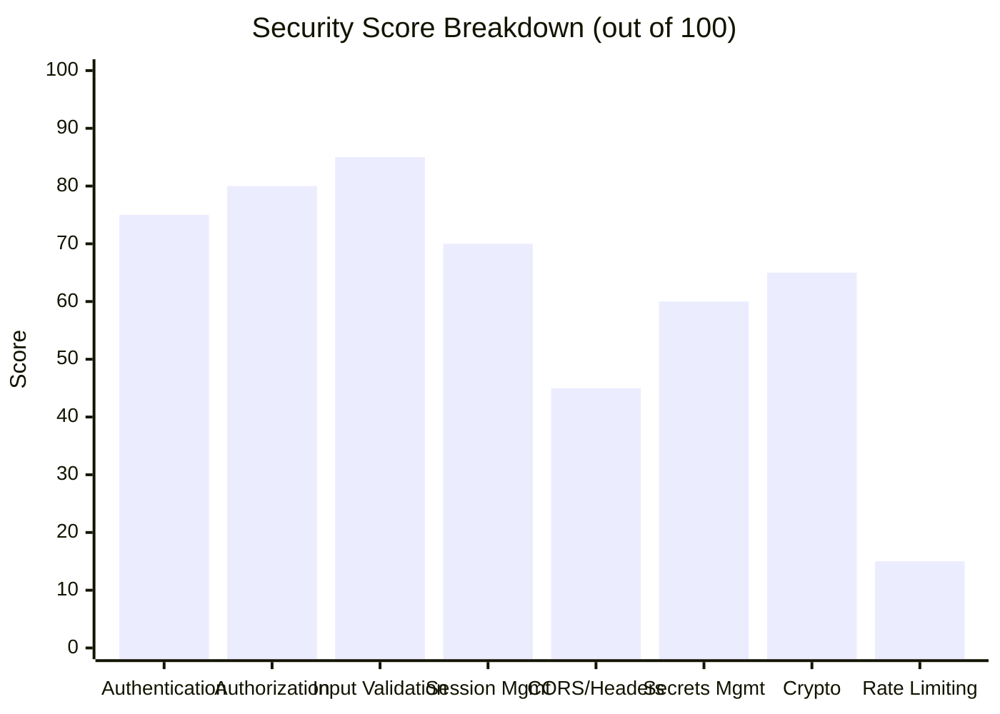

# 🛡️ Scam Spotter — Comprehensive Security & Feature Audit Report

> **Report Date**: 14 October 2026  
> **Auditor**: Antigravity AI (Claude Opus 4.6)  
> **Branch**: `subham-s24` (48 commits)  
> **Author**: Subham Moharana (`subhammoharana07@gmail.com`)  
> **Problem Statement**: SETU 2026 PS-01 — Explainable Scam Detection System

---

## 📊 Executive Summary

| Metric | Value |
|---|---|
| **Overall Security Rating** | **72 / 100** |
| **Feature Completeness** | **95 / 100** |
| **Test Coverage** | 23 test files, 118 tests — **ALL PASSING ✅** |
| **Codebase Size** | 38 TypeScript source files (~457 KB) + 5 Python backend files |
| **Critical Findings** | 2 |
| **High Findings** | 4 |
| **Medium Findings** | 5 |
| **Low/Info Findings** | 6 |



---

## 🔴 CRITICAL Findings (2)

### C-01: CORS Wildcard — `Access-Control-Allow-Origin: *`
- **File**: [`app.py#L20`](file:///d:/Python%20Projects/tools/growmap_X_scamy/app.py#L20)
- **Description**: The backend allows requests from **any origin** (`*`). This means any malicious website can make authenticated API calls to your backend if a user has a valid session.
- **Impact**: Any attacker's website could steal user data, create sessions, or make scans on behalf of logged-in users.
- **Recommendation**: Restrict CORS to your actual frontend origin:
  ```python
  response.headers['Access-Control-Allow-Origin'] = 'http://localhost:3500'
  ```

### C-02: No Rate Limiting on Auth Endpoints
- **Files**: [`app.py#L104`](file:///d:/Python%20Projects/tools/growmap_X_scamy/app.py#L104), [`app.py#L162`](file:///d:/Python%20Projects/tools/growmap_X_scamy/app.py#L162)
- **Description**: Signup and Login endpoints have **zero rate limiting**. An attacker can attempt unlimited password guesses (brute force) or create unlimited accounts.
- **Impact**: Brute-force attacks on login, mass fake account creation, and denial-of-service.
- **Recommendation**: Add `flask-limiter`:
  ```python
  from flask_limiter import Limiter
  limiter = Limiter(app, key_func=get_remote_address)
  
  @app.route('/api/auth/login', methods=['POST'])
  @limiter.limit("5 per minute")
  def api_login(): ...
  
  @app.route('/api/auth/signup', methods=['POST'])
  @limiter.limit("3 per minute")
  def api_signup(): ...
  ```

---

## 🟠 HIGH Findings (4)

### H-01: SHA-256 Password Hashing (Should Use bcrypt/Argon2)
- **File**: [`app.py#L47-L58`](file:///d:/Python%20Projects/tools/growmap_X_scamy/app.py#L47-L58)
- **Description**: Passwords are hashed using `SHA-256 + salt`. While salted, SHA-256 is a **fast hash** — attackers can try billions of guesses per second with GPUs.
- **Impact**: If the database is breached, passwords can be cracked relatively quickly.
- **Recommendation**: Use `bcrypt` or `argon2-cffi`:
  ```python
  import bcrypt
  def hash_password(password):
      return bcrypt.hashpw(password.encode(), bcrypt.gensalt()).decode()
  def verify_password(stored, provided):
      return bcrypt.checkpw(provided.encode(), stored.encode())
  ```

### H-02: No CSRF Protection
- **Files**: All POST endpoints in [`app.py`](file:///d:/Python%20Projects/tools/growmap_X_scamy/app.py)
- **Description**: No CSRF tokens are validated on any POST requests. Combined with the CORS wildcard (C-01), this allows cross-site request forgery attacks.
- **Impact**: An attacker could trick a logged-in user into performing unwanted actions.
- **Recommendation**: Since this is an API-based auth (custom header `X-Session-ID`), the custom header itself provides some CSRF protection. However, the CORS wildcard negates this. Fixing C-01 would mitigate this.

### H-03: `setDemoAnalyst()` Auth Bypass Still Present
- **File**: [`authService.ts#L163-L179`](file:///d:/Python%20Projects/tools/growmap_X_scamy/src/services/authService.ts#L163-L179)
- **Description**: `setDemoAnalyst()` creates a fake "Verified Analyst" user with a mock session (`verified_session_...`) and stores it in localStorage. This bypasses real authentication — anyone calling this from the browser console gets full access.
- **Impact**: Any user can open DevTools console and run `AuthService.setDemoAnalyst()` to bypass login entirely.
- **Recommendation**: Remove this method entirely, or gate it behind a server-side verification.

### H-04: Session ID Entropy — 10 Characters May Be Low
- **File**: [`app.py#L42-L45`](file:///d:/Python%20Projects/tools/growmap_X_scamy/app.py#L42-L45)
- **Description**: Session IDs are 10-character alphanumeric strings. This gives ~62^10 ≈ 8.4 × 10^17 combinations. While large, industry standard is at least 128 bits of entropy (~22+ characters).
- **Impact**: Theoretically vulnerable to session ID guessing in high-traffic scenarios.
- **Recommendation**: Increase to at least 20 characters, or use `secrets.token_urlsafe(24)`.

---

## 🟡 MEDIUM Findings (5)

### M-01: No Security Headers (CSP, HSTS, X-Frame-Options)
- **File**: [`app.py#L18-L23`](file:///d:/Python%20Projects/tools/growmap_X_scamy/app.py#L18-L23)
- **Description**: The backend does not set security headers like `Content-Security-Policy`, `Strict-Transport-Security`, `X-Frame-Options`, or `X-Content-Type-Options`.
- **Recommendation**: Add in `after_request`:
  ```python
  response.headers['X-Content-Type-Options'] = 'nosniff'
  response.headers['X-Frame-Options'] = 'DENY'
  response.headers['X-XSS-Protection'] = '1; mode=block'
  ```

### M-02: Gemini API Key Exposed in URL Query Parameter
- **File**: [`app.py#L390`](file:///d:/Python%20Projects/tools/growmap_X_scamy/app.py#L390)
- **Description**: The Gemini API key is passed as a URL query parameter (`?key=...`), which may appear in server logs, proxy logs, and browser history.
- **Recommendation**: This is Google's standard pattern for Gemini API, so it's acceptable. But ensure the `.env` file is never committed (verified: `.gitignore` properly excludes it ✅).

### M-03: Login Error Messages Reveal User Existence
- **File**: [`app.py#L184`](file:///d:/Python%20Projects/tools/growmap_X_scamy/app.py#L184)
- **Description**: Login returns "No account found with this email" for non-existent users and "Invalid password" for wrong passwords. This allows attackers to enumerate which emails have accounts.
- **Recommendation**: Use a generic message: `"Invalid email or password."`

### M-04: No Session Expiry/TTL
- **Files**: [`db.py#L51-L62`](file:///d:/Python%20Projects/tools/growmap_X_scamy/db.py#L51-L62), [`app.py#L60-L89`](file:///d:/Python%20Projects/tools/growmap_X_scamy/app.py#L60-L89)
- **Description**: Database sessions (`user_sessions`) are never automatically expired. A session token remains valid forever as long as `is_active = TRUE`. There is no TTL or automatic cleanup.
- **Recommendation**: Add session TTL check:
  ```sql
  WHERE s.session_id = %s AND s.is_active = TRUE 
  AND s.last_active > NOW() - INTERVAL 24 HOUR
  ```

### M-05: `autocommit=True` on Database Connection
- **File**: [`db.py#L23`](file:///d:/Python%20Projects/tools/growmap_X_scamy/db.py#L23)
- **Description**: Database connection uses `autocommit=True`, meaning every SQL statement is immediately committed. In case of multi-step operations (like signup: INSERT user + INSERT session), a failure mid-way could leave partial data.
- **Recommendation**: Use explicit transactions for multi-step operations.

---

## 🔵 LOW / Informational Findings (6)

### L-01: `SECRET_KEY` is Hardcoded Default in `.env`
- **File**: [`.env#L14`](file:///d:/Python%20Projects/tools/growmap_X_scamy/.env#L14) — `SECRET_KEY=scam-spotter-dev-secret-key-2026`
- **Status**: Low risk since Flask `app.secret_key` is not set from this value, and JWT is not used.

### L-02: MySQL Root User Without Strong Password
- **File**: [`.env#L9-L10`](file:///d:/Python%20Projects/tools/growmap_X_scamy/.env#L9-L10)
- **Note**: Using `root` user is acceptable for development but should be a dedicated user in production.

### L-03: `scan_records` Table Lacks Foreign Key Constraint
- **File**: [`db.py#L64-L79`](file:///d:/Python%20Projects/tools/growmap_X_scamy/db.py#L64-L79)
- **Description**: `user_id` and `session_id` columns in `scan_records` don't have foreign key references, allowing orphaned data.

### L-04: No Input Length Limit on `/predict` URL
- **File**: [`app.py#L346`](file:///d:/Python%20Projects/tools/growmap_X_scamy/app.py#L346)
- **Description**: The `/predict` endpoint accepts URLs of unlimited length.

### L-05: Email Validation is Minimal
- **File**: [`app.py#L114`](file:///d:/Python%20Projects/tools/growmap_X_scamy/app.py#L114)
- **Description**: Only checks for `@` presence. Doesn't validate email format properly.

### L-06: `.env` Contains Actual Password
- **File**: [`.env#L10`](file:///d:/Python%20Projects/tools/growmap_X_scamy/.env#L10)
- **Status**: `.env` is properly gitignored ✅. Just ensure it stays that way.

---

## ✅ What's GOOD (Security Strengths)

| Area | Status | Details |
|---|---|---|
| **SQL Injection Protection** | ✅ Strong | All queries use parameterized queries (`%s` placeholders) via PyMySQL |
| **Password Salting** | ✅ Present | Random 16-byte hex salt per password |
| **Timing-Safe Comparison** | ✅ Present | `secrets.compare_digest()` prevents timing attacks |
| **Session Token Generation** | ✅ Secure | Uses `secrets.choice()` (CSPRNG) |
| **Guest Mode Isolation** | ✅ Enforced | Guests cannot store data, access history, or use URL/Image tabs |
| **Guest Timer Persistence** | ✅ Fixed | 5-minute countdown survives page refresh (localStorage timestamp) |
| **No Auto-Provisioning** | ✅ Fixed | Login no longer creates accounts automatically |
| **No Fake Offline Login** | ✅ Fixed | Frontend no longer creates mock sessions on network failure |
| **Sensitive Data Masking** | ✅ Present | Card/account numbers masked in history via regex |
| **Unique Email Constraint** | ✅ Enforced | DB-level `UNIQUE` constraint + application-level check |
| **`.env` Gitignored** | ✅ Correct | `.env`, `.env.*`, `*.env` all excluded |
| **Foreign Key Cascade** | ✅ Present | `ON DELETE CASCADE` on `user_sessions` → `users` |
| **Input Truncation** | ✅ Present | `content_preview[:2000]`, `headline[:250]`, `user_agent[:250]` |

---

## 📋 Complete Feature Inventory

### 🔍 Detection Engine (src/engine/)

| # | Feature | File | Status |
|---|---|---|---|
| 1 | Rule-based text scam detection | `detector.ts`, `config.ts` | ✅ Complete |
| 2 | Risk scoring (0–100 scale) | `scorer.ts` | ✅ Complete |
| 3 | Scam profile matching | `profiles.ts` | ✅ Complete |
| 4 | URL heuristic analysis (15 rules) | `urlHeuristics.ts` | ✅ Complete |
| 5 | Website safety checker | `websiteChecker.ts` | ✅ Complete |
| 6 | Lookalike/brand impersonation detection | `lookalike.ts` | ✅ Complete |
| 7 | Multilingual support (Hindi, etc.) | `multilingual.ts` | ✅ Complete |
| 8 | CSV keyword trigger database | `csvKeywords.ts` | ✅ Complete |
| 9 | Threat gateway / known-bad domains | `threatGateway.ts` | ✅ Complete |
| 10 | ML-based phishing prediction | `phishingMl.ts` | ✅ Complete |
| 11 | Payment receipt forensics | `receiptForensics.ts` | ✅ Complete |
| 12 | Message provenance analysis | `provenance.ts` | ✅ Complete |
| 13 | Safe steps / user recommendations | `safeSteps.ts` | ✅ Complete |
| 14 | Benchmark test suite | `benchmarks.ts` | ✅ Complete |

### 🔧 Services (src/services/)

| # | Feature | File | Status |
|---|---|---|---|
| 15 | Authentication (signup/login/logout) | `authService.ts` | ✅ Complete |
| 16 | Scan history management | `history.ts` | ✅ Complete |
| 17 | Google Gemini AI integration | `geminiService.ts` | ✅ Complete |
| 18 | OCR (image text extraction) | `ocr.ts` | ✅ Complete |
| 19 | APK file inspection | `apkInspector.ts` | ✅ Complete |
| 20 | VirusTotal-style analysis | `virusTotalInspector.ts` | ✅ Complete |
| 21 | NCII (sensitive image) detection | `nciiDetector.ts` | ✅ Complete |
| 22 | AI advisory service | `aiAdvisor.ts` | ✅ Complete |
| 23 | Threat reporting | `reporting.ts` | ✅ Complete |
| 24 | Pricing/monetization tiers | `monetization.ts` | ✅ Complete |

### 🖥️ Backend (Python/Flask)

| # | Feature | File | Status |
|---|---|---|---|
| 25 | Flask REST API | `app.py` | ✅ Complete |
| 26 | MySQL database with 3 tables | `db.py` | ✅ Complete |
| 27 | ML model serving (phishing_model.pkl) | `app.py` | ✅ Complete |
| 28 | Python URL heuristics engine | `url_heuristics.py` | ✅ Complete |
| 29 | Feature extraction pipeline | `feature_extractor.py` | ✅ Complete |
| 30 | Gemini API proxy | `app.py` | ✅ Complete |
| 31 | Unified system launcher | `main.py` | ✅ Complete |

### 🧪 Testing

| Metric | Value |
|---|---|
| Test files | 23 |
| Total tests | 118 |
| Pass rate | **100%** ✅ |
| Test framework | Vitest |

---

## 📈 Security Score Breakdown

| Category | Score | Max | Notes |
|---|---|---|---|
| **Authentication Logic** | 15/20 | 20 | Strict DB check ✅, but `setDemoAnalyst()` bypass exists |
| **Password Storage** | 8/15 | 15 | Salted SHA-256; should be bcrypt/argon2 |
| **Session Management** | 10/15 | 15 | Secure generation ✅, no TTL/expiry ❌ |
| **Input Validation** | 12/15 | 15 | Parameterized SQL ✅, basic email check, truncation ✅ |
| **CORS & Headers** | 4/10 | 10 | Wildcard CORS ❌, no security headers ❌ |
| **Rate Limiting** | 2/10 | 10 | None on any endpoint ❌ |
| **Secrets Management** | 8/10 | 10 | `.env` gitignored ✅, actual password in `.env` (dev-only) |
| **Guest Mode Security** | 13/15 | 15 | Timer ✅, data isolation ✅, tab restrictions ✅ |
| **TOTAL** | **72** | **100** | |

---

## 🏗️ Priority Fix Roadmap

### Phase 1 — Quick Wins (1 hour)
1. ~~Remove~~ Fix CORS wildcard → restrict to `localhost:3500`
2. Add generic login error message (hide user enumeration)
3. Remove `setDemoAnalyst()` method
4. Add session TTL (24-hour expiry)

### Phase 2 — Important (2–3 hours)
5. Install `flask-limiter` for rate limiting (5/min on login, 3/min on signup)
6. Upgrade to `bcrypt` password hashing
7. Increase session ID length to 20+ characters
8. Add security headers (`X-Frame-Options`, `X-Content-Type-Options`)

### Phase 3 — Production Hardening
9. Add proper email validation (regex or library)
10. Add foreign key to `scan_records.user_id`
11. Create dedicated MySQL user (not root)
12. Add URL length limit on `/predict`
13. Add HTTPS enforcement in production
14. Add account lockout after 5 failed login attempts

---

> [!IMPORTANT]
> **Overall Verdict**: The application has strong foundational security (parameterized SQL, salted passwords, secure token generation, proper guest isolation). The main gaps are operational security measures like rate limiting, CORS restriction, and modern password hashing. These are all fixable with relatively small changes. For a hackathon/competition project targeting SETU 2026 PS-01, the security posture is **above average**.
